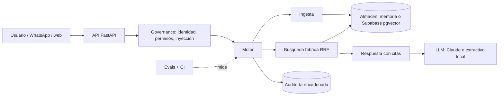

# equilibrio-motor

Motor de IA reutilizable para responder preguntas sobre documentos **con la cita exacta** (documento y página), con evaluación automática de calidad y controles de seguridad desde el diseño.

Es la base común de tres productos: búsqueda documental para organizaciones (Knowledge AI), documentación para rehabilitación (Triada) y una capa de evaluación y cumplimiento para sistemas de IA.

## Qué hace

| Pieza | Qué resuelve | Dónde está |
| --- | --- | --- |
| Ingesta | PDF, DOCX y TXT a fragmentos que conservan su número de página | `core/ingesta` |
| RAG con citas | Búsqueda híbrida (vector + palabras, fusión RRF) y respuesta citada | `core/rag` |
| Anti-invención | Tres barreras: sin evidencia no se llama al modelo; el modelo puede declarar "no encontrado"; respuesta sin cita válida se descarta | `core/rag/respuesta.py` |
| Evals | Exactitud, recuperación, cita correcta, fidelidad, rechazo correcto y latencia; fallan el CI si empeoran | `core/evals` |
| Governance | Roles y permisos, auditoría encadenada por hash, aprobación humana, detección de prompt injection, enmascarado de RUT/correo/teléfono | `core/governance` |
| API | FastAPI con clave por organización; cada endpoint pasa por identidad, permiso y auditoría | `apps/api` |
| Base de datos | Postgres + pgvector en Supabase, RLS activado, auditoría de solo inserción | `supabase/migrations` |

## Arquitectura



Cada pieza externa (almacén, embeddings, modelo) está detrás de una interfaz. Por eso el mismo motor corre **sin claves ni internet** para pruebas y demos, y con Supabase + Claude en producción, cambiando solo variables de entorno.

## Probarlo en 2 minutos (sin claves)

```bash
pip install -r requirements-dev.txt
make test          # 49 pruebas
make evals         # corre el dataset de demostración y escribe evals/reportes/ultimo.md
make demo          # API + página de demo en http://localhost:8000 (clave: demo-admin)
```

## Resultados de los evals (modo local)

Dataset de demostración: 17 preguntas sobre dos documentos ficticios (13 con respuesta, 4 sin respuesta).

| Métrica | Resultado |
| --- | --- |
| Exactitud | 92,3% |
| Recuperación de la página correcta | 100% |
| Fidelidad (nada inventado) | 100% |
| Rechazo correcto de preguntas sin respuesta | 100% |

El caso que falla es una paráfrasis ("llega tarde" por "atraso"): el modo local solo calza palabras, no significado. Es el límite conocido que resuelven los embeddings semánticos y Claude en producción. Estos números miden el modo local sobre un dataset chico; no son una promesa de rendimiento con documentos reales.

## Estado

| Componente | Estado |
| --- | --- |
| Motor, governance y API en modo local | Probado (49 pruebas automáticas + evals) |
| Migración SQL de Supabase | Aplicada y probada con SQL (búsquedas, aislamiento por organización, auditoría inmutable) |
| `AlmacenSupabase`, `RegistroSupabase` | Probados contra Supabase real en un servidor propio: subida de documento, búsqueda con cita y cadena de auditoría íntegra |
| `LLMAnthropic` (Claude) y `EmbedderVoyage` | Escritos, **sin probar con claves reales** |
| Cola de aprobaciones | En memoria (la tabla `motor_acciones` ya existe en la migración) |
| Autenticación | Claves por organización; siguiente paso: Supabase Auth (JWT) |
| Límite de peticiones (rate limiting) | Pendiente |

## Producción

1. Aplica `supabase/migrations/0001_motor_inicial.sql` en un proyecto de Supabase.
2. Copia `.env.example` a `.env` y completa las claves (nunca las subas al repositorio).
3. `docker compose up -d --build`
4. Ajusta `MOTOR_UMBRAL` corriendo los evals con tus documentos reales.

## Seguridad y datos

- Cada búsqueda filtra por organización; hay pruebas que verifican que una organización no ve datos de otra.
- Los registros enmascaran RUT, correos y teléfonos antes de guardarse.
- El contenido de los documentos se trata como datos: los fragmentos con instrucciones dirigidas al modelo no se indexan.
- La detección de inyección por patrones es una primera barrera, no una garantía.
- Antes de usar datos personales o de salud reales, revisa el cumplimiento de las leyes 19.628/21.719 y 20.584 con un abogado.

## Estructura

```
core/ingesta      extracción y fragmentación
core/rag          embeddings, almacén, búsqueda, modelo, respuesta
core/evals        runner y métricas
core/governance   permisos, auditoría, aprobaciones, inyección, privacidad
apps/api          API FastAPI y página de demo
supabase/         migraciones SQL
evals/            documentos, datasets y reportes
tests/            pruebas automáticas
```
